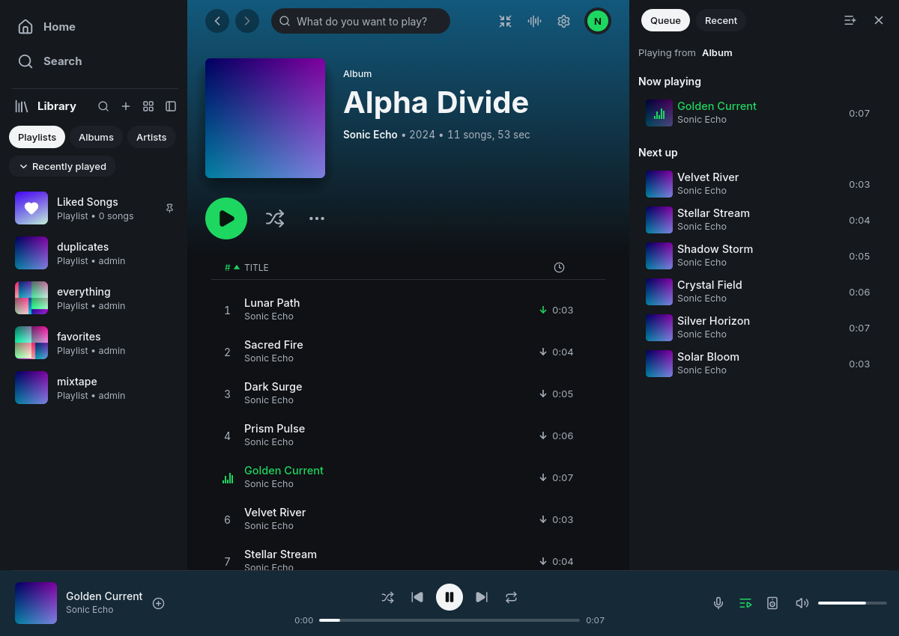

# Sonicfast

Sonicfast is a native desktop music client for OpenSubsonic/Subsonic servers,
built in Rust with egui. It is a fork of [Spotifast](https://github.com/crmne/spotifast)
by Carmine Paolino. Sonicfast keeps the original interface, native audio output,
equalizer, visualizers and Winamp-style mini-player while using your own music
server through [Libresonic](https://github.com/1800alex/libresonic).



*Native Sonicfast on Linux, using the disposable demo library.*

## Features

- Browse and search artists, albums, songs and server playlists.
- Save multiple server connections, switch between them, and refresh library metadata with Sync now.
- Play MP3, FLAC and M4A (AAC-LC/ALAC), with pause, seek, shuffle and a local queue.
- Create and edit server playlists, including duplicate-song confirmation.
- Heart songs, assign 1–5 stars, and show plain or synchronized lyrics through LRCLIB.
- Enable scrobbling with configurable listening thresholds.
- Download original files in the background, manage the queue, and prefer local
  originals for playback. Availability comes from direct filesystem checks;
  no recursive library scan or persistent download index is required.
- Send music to Snapserver and receive synchronized PCM/FLAC audio with the built-in Snapcast receiver.
- Choose AirPlay Classic, PIN-paired AirPlay receivers (including Roku), Chromecast or an MPD server from the output picker; see the [casting guide](docs/_guide/casting.md) for supported receivers and limits.
- Choose audio outputs and use the retained EQ, visualizers, themes and classic
  Winamp mini-player.

Sonicfast is under active development. Linux/Navidrome has native integration
coverage, with targeted checks against other subsonic api compatible daemons.
Physical hardware, other operating systems and release packages need further validation.
General remote queue control, podcasts and radio remain outside the
current scope. AirPlay and Cast outputs extend the original casting deferral.
Snapcast transport is available from 0.15.0; physical multiroom
synchronization still needs hardware validation.

## Build and run

Clone this repository and build normally. Cargo fetches the published
[Libresonic](https://crates.io/crates/libresonic) crates automatically;
no separate checkout is required.

On Debian/Ubuntu, install the native build prerequisites:

```sh
sudo apt install build-essential pkg-config cmake clang libclang-dev \
  libasound2-dev libpipewire-0.3-dev libxkbcommon-dev libwayland-dev \
  libgl1-mesa-dev
cargo run --locked --bin sonicfast
```

Rust is pinned in `rust-toolchain.toml`. PipeWire development headers are
required for the default native audio build. See [CONTRIBUTING.md](CONTRIBUTING.md)
for checks and toolchain limits. The ordinary Cargo default also runs Sonicfast.

The Makefile provides shortcuts for development:

```sh
make help       # List targets
make fmt        # Format Rust code
make test       # Run tests
make build      # Debug binary: target/debug/sonicfast (also: make debug)
make release    # Optimized binary: target/release/sonicfast
make run        # Build and launch the debug binary
make verify     # Run all contributor checks
```

Targets use the pinned Rust toolchain by default. To explicitly use another
installed toolchain, pass `CARGO='cargo +stable'`, for example
`make build CARGO='cargo +stable'`. Run targets accept arguments through `ARGS`,
such as `make run ARGS='--help'`. Standard Cargo environment variables still apply.

Enter your server URL and password or API key in the native sign-in form.
Self-hosted plaintext HTTP requires explicit opt-in. Remembered sign-in uses the
system credential store. Manage saved connections in Settings → Server; only one
is connected at a time. Disconnect keeps its remembered login, while Remove
forgets the connection. Sync now reloads server metadata while playback continues.
Sonicfast has its own configuration/state directories.
Existing Sonicfast profiles and downloads keep their locations after the rename.

In the bottom player bar, click the outlined plus to save a song to Liked Songs.
Once saved, its filled heart opens the existing playlist picker. Ratings are in
the song's track menu, also available by right-clicking the player title or cover.

The retained `sonicfast-legacy` executable runs the inherited Spotify/demo code
for regression comparisons and uses a separate application identity. It is not
needed to connect to an OpenSubsonic server.

## Development and validation

Start with [DESIGN.md](DESIGN.md), the [architecture decisions](docs/design/adr-002-protocol-facade.md),
and the [server evidence matrix](docs/design/server-matrix.md). Historical design
reports preserve the upstream names and the evidence recorded at the time.
The disposable Navidrome fixture is in
[Libresonic's integration directory](https://github.com/1800alex/libresonic/blob/main/integration/navidrome/README.md).

The public [guides](https://1800alex.github.io/sonicfast/) cover setup, playback,
playlists, lyrics, scrobbling and downloads. See [PACKAGING.md](PACKAGING.md) for
GitHub Pages setup, release tags, package targets and validation boundaries.
Release workflows use this repository's source and destinations. Self-updates
remain disabled; install new versions manually.

## Credits and license

Sonicfast is derived from Spotifast, retaining its MIT license and upstream notices.
Thanks to Carmine Paolino and the Spotifast contributors, the fastframe and
librespot projects used by the retained foundation, and the OpenSubsonic,
Navidrome and LRCLIB communities. See [LICENSE](LICENSE).

## Snapcast

Open **Settings → Snapcast** to send music to a Snapserver TCP source or receive
PCM/FLAC streams directly; no companion `snapclient` is required. Receiving is also
available from the sign-in screen. Both modes are disabled by default and require
explicit consent to unencrypted transport on a trusted network. Use both modes
to hear your own source through the synchronized receiver.

`make snapcast-test` runs the Docker integration suite. For an independent manual
playground, run `make snapcast-smoke-up` and `make snapcast-smoke-tone`, then point
the receiver at `127.0.0.1:1714`. Stop the tone before sending your own music to
source port `4993`. See [Snapcast setup and smoke instructions](integration/snapcast/README.md).
